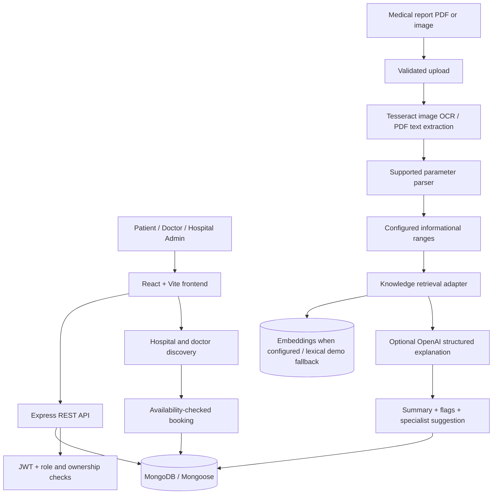

# BookMyAppointment AI

## Project Overview

BookMyAppointment AI is an AI-assisted healthcare platform that brings medical report summaries, symptom-based specialist suggestions, hospital and doctor discovery, and appointment booking into one place. It is an informational tool, not a disease diagnosis system.

## Problem

Patients can find medical reports difficult to understand, may not know which specialist to contact, and often have to search across several services to find care and a suitable appointment.

## Objectives

- Help patients organize and review medical reports in plain language.
- Suggest a specialist to consider from symptoms or report terms.
- Make it easier to discover nearby hospitals, departments and doctors.
- Let patients book, review and cancel appointments.
- Compare values recorded in previous reports without making claims about disease progression.
- Give doctors and hospital administrators role-specific tools for schedules and report workflows.
- Protect sensitive reports with authentication, role checks and patient-controlled sharing.

## How We Built It

1. Built a responsive React frontend with Vite, Tailwind CSS, React Router and Recharts.
2. Created a modular Node.js and Express REST API.
3. Implemented password hashing, JWT sessions and role-based authorization.
4. Added Patient, Doctor and Hospital Admin roles.
5. Added city-based hospital and doctor discovery with specialty filters.
6. Implemented rule-based, informational specialist suggestions.
7. Added PDF and image report upload with file validation and size limits.
8. Added Tesseract OCR for JPG/PNG images and text extraction for searchable PDFs.
9. Parsed only supported parameter values that are visibly present in extracted report text.
10. Added configurable reference-range records. The seeded intervals are illustrative demo data and must be replaced with lab-specific intervals before real use.
11. Added an optional OpenAI integration for structured plain-language explanations; rule-based summaries work without an API key.
12. Added an embedding adapter and semantic retrieval path, with local lexical search as an offline fallback.
13. Added prior-report trends and neutral value comparisons.
14. Implemented appointment booking with server-side availability checks and duplicate-slot protection.
15. Added patient, doctor and hospital report workflows with explicit patient report sharing.
16. Added an idempotent MongoDB seed for fictional Hyderabad hospital and doctor starter listings. The seed supplies a rolling 14-day appointment schedule, does not create demo patients or bookings in the connected database, and cancels older seeded fixture bookings if present.

## Architecture



## Main Features

- Patient, Doctor and Hospital Admin sign-in and role-aware navigation.
- Patient dashboard with upcoming visits, reports, health trends and care suggestions.
- City selection and hospital/doctor list discovery.
- Rule-based symptom prompts with an informational disclaimer.
- Doctor specialties, hospital association, fees, ratings and available slots.
- Appointment booking, confirmation, history and cancellation.
- Patient report upload for PDF, JPG, JPEG and PNG.
- OCR/text extraction, supported-parameter parsing, configurable informational range comparison and plain-English summaries.
- Patient permission to share a report with a care provider; providers can view reports they uploaded or those explicitly shared with them.
- Previous-report graphs and neutral comparisons for recorded values.
- Rule-based explanations and demo-only screens that can be explored without optional AI services. Hospital discovery and appointment booking require the connected MongoDB database.

## User Roles

### Patient

Register or sign in, set a city, find doctors, request a specialist suggestion, upload reports, review prior values, share reports with providers, and manage appointments.

### Doctor

Review assigned appointments, manage availability, update appointment status and upload a report for a patient who has an appointment with that doctor. Patient report access is permission based.

### Hospital Admin

Manage hospital doctor/department records, review hospital appointments, maintain doctor availability and upload reports for patients with an appointment at that hospital. Patient report access is permission based.

## AI / RAG Pipeline

`Upload → OCR or PDF text extraction → supported-value parsing → configured interval checks → knowledge retrieval → optional structured LLM explanation → stored result`

OCR and parsing do not infer missing values. The LLM receives extracted values and retrieved educational context; it is instructed not to create or alter medical values. Without an OpenAI key, a rule-based explanation is returned. Knowledge articles are split into retrievable chunks. The vector adapter uses OpenAI embeddings when configured and falls back to local lexical ranking for a no-key demo.

## Appointment Booking

The patient chooses a hospital, doctor, date, and available time. The API reads current listings and availability from MongoDB, checks for an active booking at that slot before creating the appointment, and reports the doctor's name, date, and time if another patient has just booked it. MongoDB has a unique active-slot index as a second concurrency guard. A cancelled or completed appointment releases its slot. Booking and discovery return an unavailable response instead of switching to in-memory demo data when MongoDB is disconnected.

Run `npm run seed --prefix server` to insert the starter catalog. Seeding is safe to repeat. The bundled starter hospital and doctor names are fictional sample records; replace them with verified provider records before accepting real patient bookings.

## Location

The app includes a manual city selector and hospital/doctor lists filtered to the selected city. The starter catalog currently contains fictional Hyderabad sample listings. Google Maps geocoding and current-location discovery are not configured.

## Medical Report Analysis

Patients can upload their own report. Doctors and hospital admins can upload for a patient with an existing appointment relationship. The uploaded report is only visible to the patient and the uploader until the patient explicitly shares it with another provider.

Image files use Tesseract OCR. Searchable PDFs use text extraction. Scanned PDFs without selectable text are reported as unsupported by this first version. Cloudinary is optional; without it, files are kept in protected local storage and served only after an authorization check.

## Health Trends

The trends screen derives history from dated values in uploaded reports and uses neutral wording such as “recorded value changed.” It does not infer a disease or claim a condition is getting worse. The chart includes fictional sample history for the demo; there is no separate trends collection.

## Technology Stack

| Layer | Technology |
|---|---|
| Frontend | React 18, Vite, Tailwind CSS, React Router, Axios |
| UI and charts | Lucide React, Recharts |
| Backend | Node.js, Express |
| Database | MongoDB, Mongoose (required for hospital discovery and bookings) |
| Authentication | JWT, bcryptjs |
| Uploads | Multer; optional Cloudinary storage |
| OCR / PDF | Tesseract.js, pdf-parse |
| AI / RAG | Optional OpenAI API, embedding adapter, local lexical fallback |
| Location | Manual city selection; optional location provider can be added |

## API Documentation

All routes use the `/api` prefix. Except health, hospital/doctor discovery and auth, routes require `Authorization: Bearer <JWT>`.

| Method | Route | Access | Purpose |
|---|---|---|---|
| GET | `/health` | Public | API and storage mode status |
| POST | `/auth/register` | Public | Register a patient |
| POST | `/auth/login` | Public | Sign in and receive a JWT |
| GET / PUT | `/users/profile` | Signed in | Read or update own profile |
| POST | `/symptoms/recommend-specialist` | Signed in | Rule-based specialist suggestion |
| GET | `/hospitals?city=` | Public | Search hospitals |
| GET | `/hospitals/:id` | Public | Hospital details and associated doctors |
| POST | `/hospitals` | Hospital Admin | Add a hospital |
| GET | `/doctors?city=&specialty=` | Public | Search doctors |
| GET | `/doctors/:id` | Public | Doctor details |
| GET | `/doctors/:id/availability?date=` | Public | Available slots |
| POST | `/doctors/:id/availability` | Doctor / Hospital Admin | Manage slots |
| POST | `/appointments` or `/appointments/book` | Patient | Book a slot |
| GET | `/appointments` | Signed in | Own or assigned appointment history |
| GET | `/appointments/:id` | Related user | Appointment details |
| POST | `/appointments/:id/cancel` | Related user | Cancel appointment |
| PATCH | `/appointments/:id/status` | Doctor / Hospital Admin | Confirm, complete or cancel |
| POST | `/reports/upload` | Patient | Upload own report (`report` form field) |
| POST | `/reports/:id/upload` | Doctor / Hospital Admin | Upload for an assigned patient |
| GET | `/reports` | Signed in | Own reports or provider-uploaded/shared reports |
| GET | `/reports/user/:userId` | Patient / authorized provider | Patient report history |
| GET | `/reports/:id` | Owner / uploader / shared provider | Read analysis |
| GET | `/reports/:id/file` | Owner / uploader / shared provider | Read original file |
| POST | `/reports/:id/analyze` | Authorized user | Re-run extraction and analysis |
| POST | `/reports/:id/share` | Report owner | Grant report access to a provider account |
| DELETE | `/reports/:id/share/:userId` | Report owner | Revoke provider access |
| POST | `/ai/analyze-report` | Signed in | Analyze supplied extracted report text |
| POST | `/ai/recommend-specialist` | Signed in | Specialist suggestion |
| GET | `/health-trends/:patientId` | Patient | Extracted value history |
| GET | `/medical/reference-ranges` | Signed in | Read configured informational intervals |
| PUT | `/medical/reference-ranges/:parameter` | Hospital Admin | Update an interval and its source/context |

## Database Collections

- **Users** — account credentials (hashed), role, patient profile and provider links.
- **Doctors** — specialty, hospital, experience, fee, rating and date-based availability.
- **Hospitals** — address, city/state, coordinates, departments and contact details.
- **MedicalReports** — owner/uploader, file metadata, extracted text/values, analysis and explicit sharing list.
- **Appointments** — patient, doctor, hospital, date/time, status and active-slot key.
- **MedicalKnowledge** — educational chunks and optional embedding vectors.
- **ReferenceRanges** — configurable unit, limits, population/context and source. Seeded ranges are demo-only.
- **Health trends** — derived at request time from dated report parameter values; no separate collection.

## Environment Variables

Copy `.env.example` to `server/.env`. No real keys are included.

- `PORT`, `CLIENT_URL`, `MONGODB_URI`, `JWT_SECRET`, `JWT_EXPIRES_IN`, `MAX_UPLOAD_MB`
- Optional local-only `DEMO_PASSWORD` to seed sample accounts during development.
- Optional `CLOUDINARY_CLOUD_NAME`, `CLOUDINARY_API_KEY`, `CLOUDINARY_API_SECRET`
- Optional `OPENAI_API_KEY`, `OPENAI_MODEL`, `OPENAI_EMBEDDING_MODEL`
- Optional frontend `VITE_API_URL` in `client/.env` (defaults to `http://localhost:5000/api`)

## Installation

Requirements: Node.js 20+ and npm. MongoDB and API keys are optional for local demo mode.

```bash
# from the repository root
npm install --prefix server
npm install --prefix client
npm install

# optional: copy and edit environment settings
cp .env.example server/.env

# start API and frontend together
npm run dev
```

Frontend: `http://localhost:5173`  
Backend health: `http://localhost:5000/api/health`

To run separately:

```bash
npm run dev --prefix server
npm run dev --prefix client
```

If `MONGODB_URI` is present and reachable, the server seeds fictional sample data into an empty database. Otherwise it uses an in-memory demo store. The in-memory store resets when the server restarts.

### Account setup

The app does not ship default login credentials. Public registration creates patient accounts only. Provider accounts should be provisioned by an administrator. Sample records are fictional and are for isolated development environments only.

For local development only, setting `DEMO_PASSWORD` enables demo-account seeding. Demo accounts are not seeded in production, and production sign-in rejects the `.demo` sample accounts.

## Running the Frontend

The Vite client is started by `npm run dev --prefix client`. It uses the API at `http://localhost:5000/api` by default. Without a backend it falls back to fictional client-side demo records for browsing and booking interactions.

## Running the Backend

Start the API using `npm run dev --prefix server`. Copy `.env.example` to `server/.env` and set a strong `JWT_SECRET` before exposing the service beyond a local demo. MongoDB persistence is enabled when `MONGODB_URI` is configured.

## Render Demo Deployment

The root `render.yaml` defines a single Render web service that builds the React client and serves it from the Express API. The client uses same-origin `/api` requests, and the service exposes `/api/health` as its health check. Connect this repository to Render as a Blueprint, then provide the MongoDB connection string when prompted; Render generates the JWT secret. Production startup refuses to run without a reachable MongoDB database and a JWT secret.

The Blueprint selects Render's Free plan for a capstone demo. Free services can sleep when idle and have ephemeral local filesystems, so this setup is not suitable for real patient data. Report uploads use Cloudinary when its credentials are configured; otherwise they fall back to local storage and can be lost when the service restarts or redeploys. Configure `CLOUDINARY_CLOUD_NAME`, `CLOUDINARY_API_KEY` and `CLOUDINARY_API_SECRET` before relying on report uploads. No OpenAI or embedding key is required for booking.

## Running the AI / RAG Service

AI, OCR, parsing and retrieval are modular services inside the Express backend; no second process is required. Start the backend and optionally configure `OPENAI_API_KEY` for grounded explanations and embeddings. Without the key, the rule-based explanation and lexical retrieval path run locally. Image OCR is performed by Tesseract.js. Searchable PDFs are read with `pdf-parse`.

## Folder Structure

```text
client/
  src/components/       Shared navigation and modal components
  src/data/             Fictional client demo data
  src/pages/             Patient/provider views
  src/services/          API client
  src/App.jsx             Routes and app state
  src/styles.css          Responsive product styling
server/
  src/ai/                 OCR, parsing, specialist rules, RAG and vector adapter
  src/config/             Database connection
  src/controllers/        REST request handlers
  src/data/               Fictional seed records
  src/middleware/         JWT, errors and role checks
  src/models/             Mongoose schemas
  src/routes/             REST route definitions and upload validation
  src/services/           Hybrid persistence and file storage adapters
  uploads/                Protected local report files
README.md
.env.example
```

## Future Scope

- More report formats and lab-specific range configuration.
- Scanned PDF page rendering before OCR.
- More regional-language explanations, including Telugu.
- Hospital EMR integration and provider onboarding/verification.
- Wearable data and patient-authorized integrations.
- Real-time appointment availability, notifications and calendar integration.
- Google Maps geocoding and current-location discovery.
- Production-grade audit logs, encryption/key management and consent history.

## Known Limitations

- Seed data, patient history, appointment records and demo report files are fictional.
- In-memory demo data is not persistent.
- The scanned-PDF OCR path is not enabled; selectable-text PDFs and JPG/PNG images are supported.
- Reference intervals are illustrative and are not intended for clinical decisions. The report's lab-provided interval and the patient's age, sex, pregnancy status, history and clinician assessment may change interpretation.
- Local lexical search is used when an embedding API is not configured. No clinical source documents are included in the demo knowledge set.
- Cloudinary, OpenAI and Maps integrations require user-provided credentials and deployment configuration.
- This capstone starter is not production-certified for handling real patient data; a deployment needs security, privacy, regulatory and clinical review.

## Safety Disclaimer

"This application is an AI-assisted informational tool. It does not provide a medical diagnosis or replace a licensed healthcare professional. Users should consult a qualified healthcare professional for diagnosis, treatment and medical decisions."
